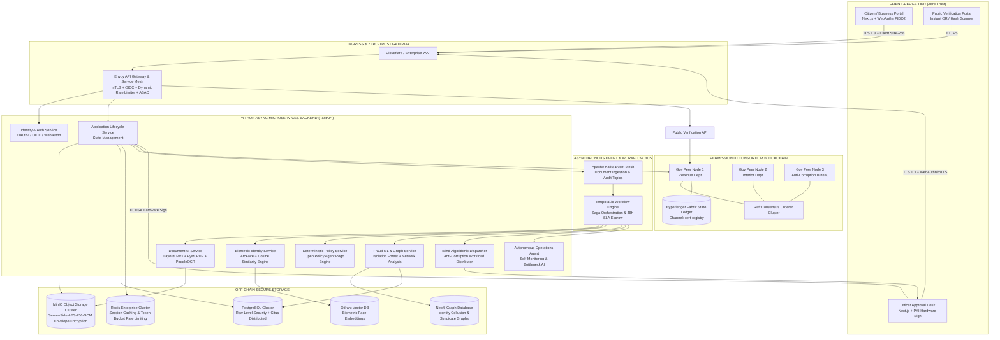
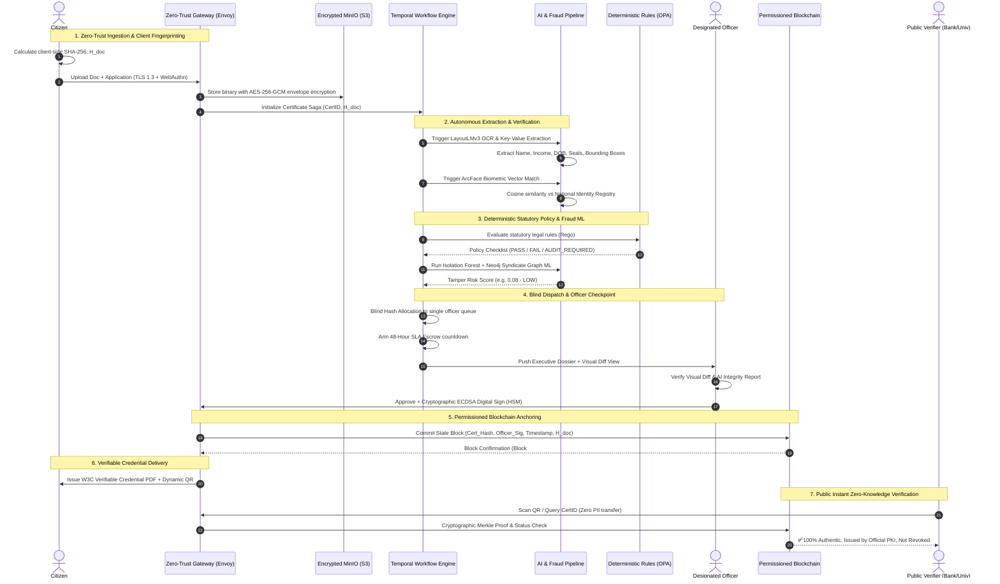

# Master System Architecture Document
## Project: GovPulse Autonomous Digital Government Certificate Platform

---

## 1. Executive Vision & Core Architecture

GovPulse is an enterprise-grade, zero-trust digital government operations platform designed to eliminate bureaucratic friction, human error, discretionary corruption, and multi-week processing delays in issuing official government certificates (e.g., Income, Domicile, Caste, Welfare, Disability, Trade Licenses).

The system replaces opaque, multi-layer manual clerk chains with an **autonomous, self-monitoring AI workflow engine** anchored by a **single accountable officer checkpoint** and a **permissioned blockchain proof registry**.

```
┌─────────────────────────────────────────────────────────────────────────────────────────────┐
│                                   CORE ARCHITECTURAL TENETS                                 │
├─────────────────────────────────────────────────────────────────────────────────────────────┤
│ 1. Decoupled Trust Model: Off-Chain AI & Encrypted Storage vs On-Chain Cryptographic Proofs  │
│ 2. Strict Determinism Boundary: Probabilistic AI (Extraction) vs OPA Rego (Legal Code)      │
│ 3. Single-Officer Accountable Checkpoint with Zero Discretionary Opacity                    │
│ 4. Absolute Privacy (Zero PII On-Chain) with W3C Verifiable Credential Portability          │
│ 5. Blind Algorithmic Dispatch & 48-Hour Strict SLA Escrow (Anti-Corruption Engine)         │
└─────────────────────────────────────────────────────────────────────────────────────────────┘
```

---

## 2. High-Level System Architecture Diagram



---

## 3. End-to-End Component Lifecycle



---

## 4. Key Architectural Separation: Off-Chain vs On-Chain

To guarantee strict compliance with data privacy laws (e.g., GDPR, National Data Protection Acts), citizen personally identifiable information (PII) is **never** committed to the blockchain.

```
┌──────────────────────────────────────────────┐  ┌──────────────────────────────────────────────┐
│        OFF-CHAIN LAYER (Confidential)        │  │         ON-CHAIN LAYER (Public Trust)        │
├──────────────────────────────────────────────┤  ├──────────────────────────────────────────────┤
│ • Full Scanned PDFs and Images               │  │ • Document SHA-256 Fingerprint ($H_{doc}$)   │
│ • Citizen Names, Tax IDs, Addresses, Photos  │  │ • Unique Certificate Hash ($H_{cert}$)       │
│ • Raw Financial & Income Figures             │  │ • Officer PKI Public Key Fingerprint         │
│ • AI Extracted Layout Bounding Boxes         │  │ • Officer ECDSA Cryptographic Signature      │
│ • Temporary Processing States & Sagas        │  │ • Transaction Timestamp & Block Merkle Root  │
│ • Neo4j Fraud Graph Relations                │  │ • Credential Lifecycle Status (VALID/REVOKED)│
│                                              │  │                                              │
│ Storage: MinIO AES-256-GCM, PostgreSQL,      │  │ Storage: Hyperledger Fabric Private Ledger   │
│          Qdrant Vector DB                    │  │          (State Database: CouchDB)           │
└──────────────────────────────────────────────┘  └──────────────────────────────────────────────┘
```

---

## 5. Architectural Quality Attributes & Non-Functional Requirements

| Metric | Specification Target | Architectural Enabler |
|---|---|---|
| **System Throughput** | 10,000 Concurrent Submissions / min | Async Python FastAPI + Kafka Event Mesh + Redis caching |
| **End-to-End Latency** | < 45 seconds (Intake to Officer Queue) | Parallelized PyTorch GPU inference workers + OPA sub-millisecond evaluation |
| **Public Verification Speed** | < 800 milliseconds | Zero-Knowledge index lookup on Blockchain State Cache |
| **High Availability** | 99.99% Uptime (Annual downtime < 52 mins) | Multi-AZ Kubernetes cluster + Raft consensus across 3+ validator peers |
| **Data Integrity & Non-Repudiation** | 100% Mathematically Proven | Client-side SHA-256 + Officer HSM ECDSA signatures + Blockchain Merkle Proofs |
| **Discretionary Bribery Index** | 0.00 (Mathematically impossible) | Blind hash dispatch + 48h SLA Escrow + Codified rejection requirements |
