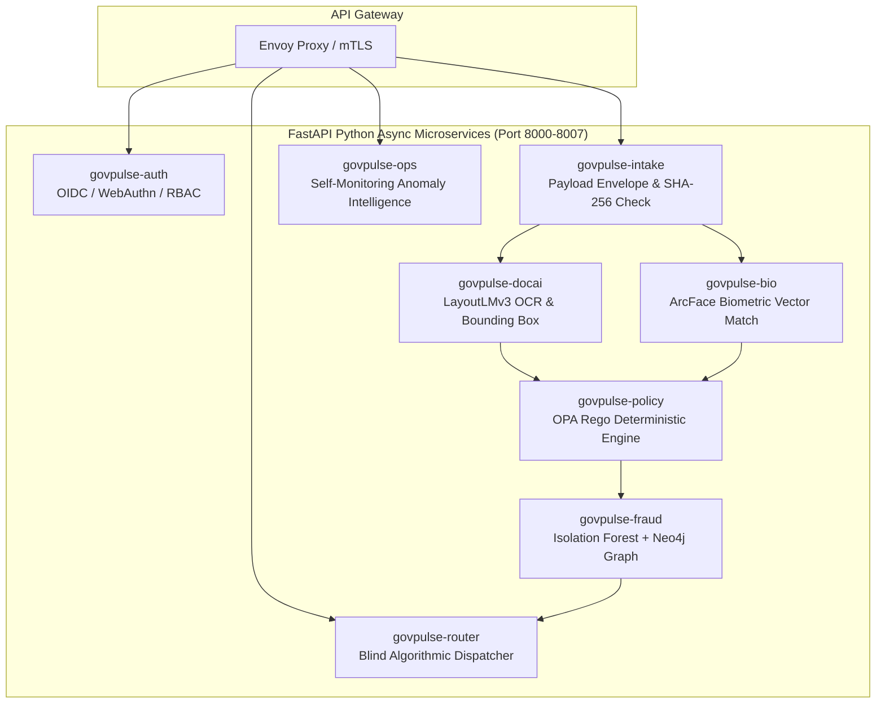
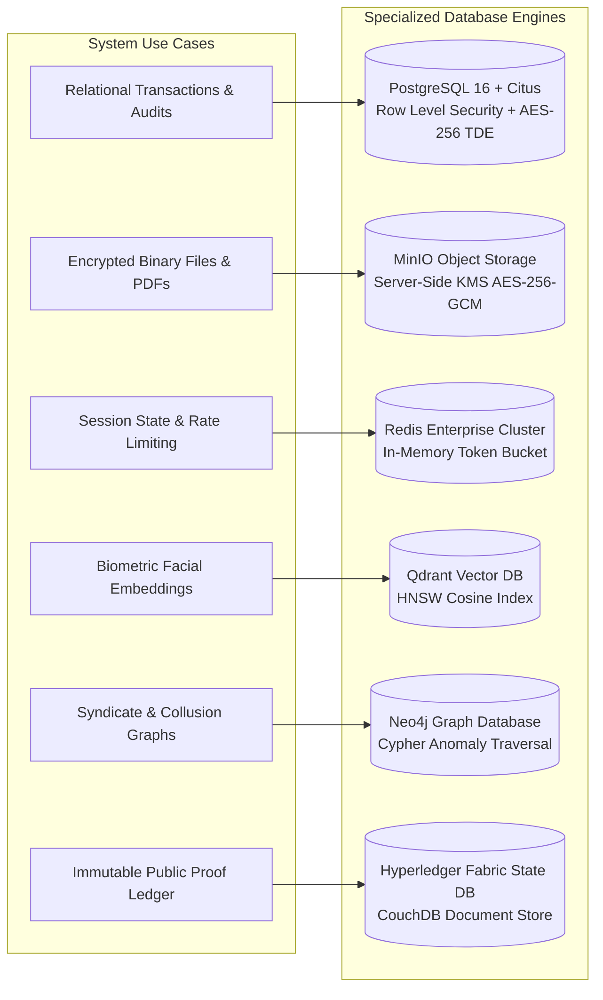
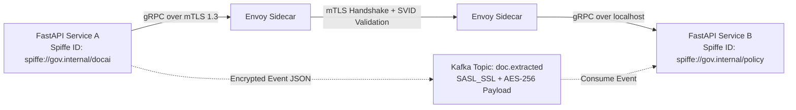

# Technology Stack & Framework Selection Document
## Project: GovPulse Autonomous Digital Government Platform

---

## 1. Frontend Framework Decision: Next.js vs. React + Vite

For an enterprise-scale, mission-critical government platform serving millions of citizens alongside authorized high-security government officials, frontend architecture requires careful trade-off analysis.

### Comparative Decision Matrix

| Architectural Criterion | Next.js 14+ (App Router) | React + Vite (Single Page App) | Winner & Critical Analysis for GovPulse |
|---|---|---|---|
| **Zero-Trust Security & Token Isolation** | **Exceptional (BFF Pattern):** Backend-for-Frontend (BFF) allows storing sensitive OAuth/OIDC tokens in HTTP-only, encrypted server session cookies. Client JavaScript never touches raw tokens. | **Moderate:** Tokens typically reside in browser `localStorage` or memory, making them vulnerable to Cross-Site Scripting (XSS) token theft. | **Winner: Next.js** (Mandatory for government-grade Zero-Trust compliance). |
| **Initial Load Performance & SEO** | **Instant (SSR / RSC):** Server-Side Rendering & Server Components deliver pre-rendered HTML with sub-second First Contentful Paint (FCP) on low-bandwidth 3G/4G citizen mobile devices. | **Slower Initial Load:** Heavy JS bundle must be downloaded and parsed before first render, leading to blank screen delays on low-end citizen devices. | **Winner: Next.js** (Crucial for universal citizen accessibility). |
| **Official Officer Workspace UI** | **Excellent:** Dynamic streaming SSR (`Suspense`), optimistic UI updates, and server actions for hardware token coordination. | **Excellent:** Rich client-side state manipulation, rapid hot-module reloading during development. | **Tie** |
| **Deployment & Security Isolation** | **Multi-Tier:** Can run in isolated Node.js container behind Envoy, serving as a hardened edge layer. | **Static CDN:** Deployable to static object storage/CDN. However, static assets require open public APIs. | **Winner: Next.js** |
| **WebAuthn / FIDO2 Integration** | Native browser WebAuthn API works seamlessly with Next.js server verification routes. | Works seamlessly via client-side WebAuthn API calling FastAPI endpoints. | **Tie** |

### Definitive Recommendation: **Next.js 14+ (App Router) with Tailwind CSS**
> **Decision Rationale:** Next.js provides the **Backend-for-Frontend (BFF)** security architecture essential for government Zero-Trust. It prevents tokens from leaking to the browser, accelerates citizen load times on mobile devices across remote regions via SSR, and enables unified API routing with automated security headers (`Strict-Transport-Security`, `Content-Security-Policy`, `X-Frame-Options: DENY`).

---

## 2. Python Backend Microservices Architecture

The entire core processing, AI, policy, and workflow backend is built on **Python 3.12+**, leveraging its unparalleled ecosystem for asynchronous microservices, deep learning inference, cryptographic binding, and mathematical data pipelines.

```
┌─────────────────────────────────────────────────────────────────────────────────────────┐
│                                PYTHON BACKEND ARCHITECTURE                              │
├─────────────────────────────────────────────────────────────────────────────────────────┤
│ • Framework: FastAPI (Async ASGI, OpenAPI 3.1, Sub-millisecond Pydantic v2 validation) │
│ • AI & Inference Engine: PyTorch 2.4+ / ONNX Runtime GPU (CUDA 12.4 acceleration)       │
│ • Document Vision: LayoutLMv3, PyMuPDF (fitz), PaddleOCR v4, OpenCV                     │
│ • Biometric Matching: InsightFace / ArcFace (ResNet-100 backbone)                       │
│ • Fraud ML & Stats: Scikit-Learn (Isolation Forest), NetworkX, PySpark                  │
│ • Deterministic Policy: Python OPA Client (`open-policy-agent` / WASM runtime)          │
│ • Workflow Orchestration: Temporal Python SDK (Stateful Saga executions)                │
│ • Cryptography: `cryptography` (OpenSSL 3.3 bindings, ECDSA, Ed25519, AES-256-GCM)     │
└─────────────────────────────────────────────────────────────────────────────────────────┘
```

### Microservices Decomposition:



---

## 3. Multi-Tier Database Architecture & Security Evaluation

A national-scale digital government platform cannot use a single monolithic database. Different workloads require distinct storage guarantees for **performance, relational integrity, vector similarity, graph relationships, and cryptographic immutability**.



### Detailed Database Evaluation Matrix

| Database Engine | Designated System Role | Storage Model | Security & Compliance Feature |
|---|---|---|---|
| **PostgreSQL 16 + Citus** | Application state, citizen profiles, officer audit logs, SLA timers. | Relational SQL (ACID) | **Row-Level Security (RLS)** restricts data visibility per tenant/district; Transparent Data Encryption (TDE); immutable append-only audit tables. |
| **MinIO Enterprise (S3 API)** | Uploaded scanned certificates, tax forms, identity card binaries. | Object Store (Blob) | **Per-Object AES-256-GCM Envelope Encryption** with external HashiCorp Vault KMS; Object Locking (WORM: Write Once, Read Many). |
| **Redis 7.4 Enterprise** | Distributed session tokens, API rate-limiting, live SLA countdown cache. | In-Memory Key-Value | TLS encrypted communication, ACL authentication, sub-millisecond response for live SLA dashboards. |
| **Qdrant Vector Database** | 512-dimensional facial biometric vector embeddings extracted via ArcFace. | HNSW Vector Index | High-dimensional cosine distance matching with hardware AVX-512 acceleration, payload filtering, and encrypted vector indices. |
| **Neo4j Enterprise** | Identity collision networks, address reuse, notary fraud syndicates. | Labeled Property Graph | Real-time Cypher graph queries detecting multi-hop collusions across unrelated applicants. |
| **Hyperledger Fabric (CouchDB)** | Block state database containing certificate hashes, issuer signatures, and status. | Distributed State Ledger | Cryptographically signed state transitions validated by multi-organization endorsement policies. |

---

## 4. Secure Inter-Service Communication Protocol

To prevent lateral movement inside the government cloud perimeter, all services adhere to **Zero-Trust Network Architecture (NIST SP 800-207)**:

```
┌─────────────────────────────────────────────────────────────────────────────────────────┐
│                           INTER-SERVICE SECURITY PROTOCOLS                              │
├─────────────────────────────────────────────────────────────────────────────────────────┤
│ 1. Synchronous Control Plane: gRPC over mTLS (Mutual TLS 1.3 with SPIFFE/SPIRE IDs)     │
│ 2. Asynchronous Data Plane: Apache Kafka with SASL/SCRAM authentication & TLS encryption│
│ 3. Internal Service Authorization: Short-lived Spiffe JWT SVID tokens verified at proxy │
│ 4. Encryption at Rest: AES-256-GCM across all database volumes (LUKS / dm-crypt)        │
│ 5. Key Management: HashiCorp Vault with Hardware Security Module (HSM) root of trust    │
└─────────────────────────────────────────────────────────────────────────────────────────┘
```



---

## 5. Complete Tech Stack Summary Table

| Category | Primary Technology | Purpose in GovPulse |
|---|---|---|
| **Frontend UI** | **Next.js 14+ / React / Tailwind CSS** | Citizen application portal & single-officer review desk with SSR security. |
| **Edge Security** | **Cloudflare Enterprise + Envoy Proxy** | WAF, DDoS mitigation, mTLS, rate limiting, and ABAC gateway. |
| **Core Backend** | **Python 3.12+ (FastAPI)** | High-performance asynchronous REST and gRPC microservices. |
| **Workflow & SLA** | **Temporal.io (Python SDK)** | Distributed state machine enforcing 48-hour hard SLA escrow. |
| **AI Document Extraction** | **LayoutLMv3 + PyMuPDF + PaddleOCR** | Multimodal OCR, key-value parsing, visual bounding boxes. |
| **Biometric Vision** | **InsightFace / ArcFace (PyTorch)** | Vectorized facial identity verification against national ID records. |
| **Statutory Policy Engine** | **Open Policy Agent (OPA) / Rego** | Deterministic legal eligibility evaluation with statutory code citations. |
| **Fraud & Anomaly ML** | **Isolation Forest + Neo4j Graph DB** | Document tampering anomaly scoring and identity syndicate detection. |
| **Relational Storage** | **PostgreSQL 16 + Citus** | Core application state with Row-Level Security (RLS). |
| **Encrypted Object Store**| **MinIO Enterprise (Vault KMS)** | Off-chain encrypted document binary storage (AES-256-GCM). |
| **Vector Database** | **Qdrant** | Biometric facial embedding similarity search. |
| **Permissioned Blockchain**| **Hyperledger Fabric v2.5** | Immutable certificate hash anchoring, public verification, and audit trail. |
| **Hardware PKI / Sign** | **WebCrypto / PKCS#11 / ECDSA P-256** | Officer digital signature committing issuance to the blockchain. |
