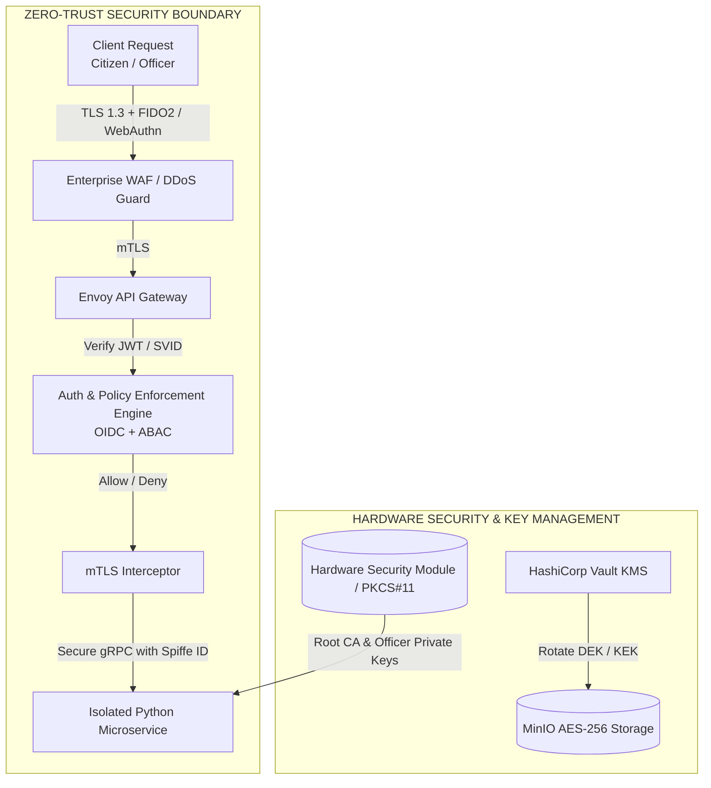
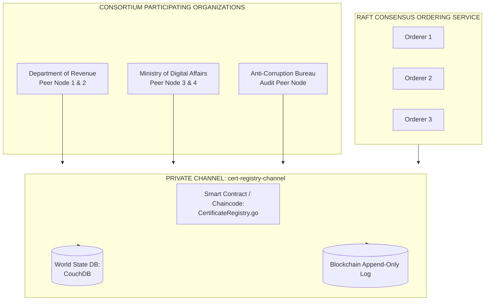
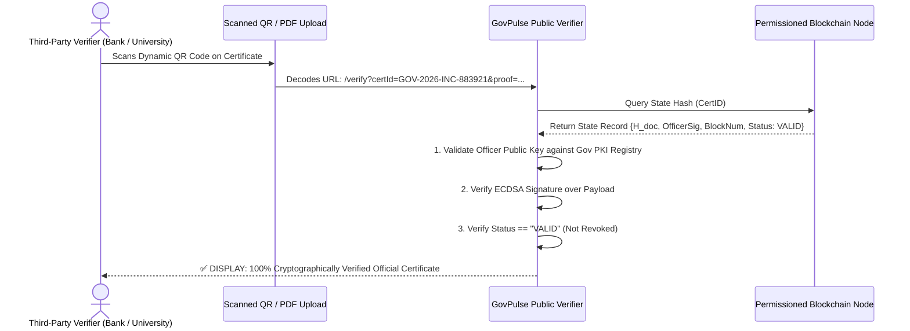

# Zero-Trust Security, Cryptography & Blockchain Architecture
## Project: GovPulse Autonomous Digital Government Platform

---

## 1. Zero-Trust Security Framework (NIST SP 800-207)

GovPulse treats all networks, internal microservices, and external clients as inherently hostile. Every interaction requires **explicit authentication, granular authorization, and end-to-end cryptographic integrity**.



---

## 2. Cryptographic Protocols & Mathematical Formulations

```
┌─────────────────────────────────────────────────────────────────────────────────────────┐
│                               CRYPTOGRAPHIC PRIMITIVES SUMMARY                          │
├─────────────────────────────────────────────────────────────────────────────────────────┤
│ 1. Document Hashing: SHA-256 (NIST FIPS 180-4)                                          │
│ 2. Payload Encryption at Rest: AES-256-GCM (Envelope Encryption via Vault KMS)          │
│ 3. Digital Signatures: ECDSA with curve SECP256R1 / Ed25519 (RFC 8032)                  │
│ 4. Blockchain Proofs: SHA-256 Merkle Trees & State Hash Commitments                     │
│ 5. Public Credential Standard: W3C Verifiable Credentials v2.0 with JSON Web Signatures │
└─────────────────────────────────────────────────────────────────────────────────────────┘
```

### 1. Client-Side Document Fingerprinting
Before binary upload, the client computes the immutable document hash:
$$H_{\text{doc}} = \text{SHA-256}(\text{RawFileBytes})$$

### 2. Envelope Encryption Formulation (AES-256-GCM)
For every document $D$:
1. Vault KMS generates a unique Data Encryption Key (DEK).
2. The document is encrypted:
   $$\text{Ciphertext}, \text{AuthTag} = \text{AES-256-GCM}_{DEK}(D, \text{IV}, \text{AAD})$$
   *(where AAD includes ApplicationID and CitizenID for cryptographic binding).*
3. The DEK is encrypted with the Master Key Encryption Key (KEK):
   $$E_{\text{DEK}} = \text{AES-256-GCM}_{KEK}(DEK)$$
4. MinIO stores $\{\text{Ciphertext}, \text{AuthTag}, \text{IV}, E_{\text{DEK}}\}$.

### 3. Officer Digital Signature (ECDSA / Ed25519)
The responsible officer approves by signing the Canonical Certificate Payload:
$$\text{Payload} = \text{CanonicalJSON}(\text{CertID}, H_{\text{doc}}, \text{CitizenIdentityHash}, \text{EligibilityState}, \text{Timestamp})$$
$$\text{Sig}_{\text{officer}} = \text{Sign}_{SK_{\text{officer}}}(\text{SHA-256}(\text{Payload}))$$

### 4. Blockchain State Hash Commitment
The state committed to the permissioned blockchain ledger is defined as:
$$H_{\text{state}} = \text{SHA-256}(\text{CertID} \parallel H_{\text{doc}} \parallel \text{OfficerPKIFingerprint} \parallel \text{Sig}_{\text{officer}} \parallel \text{Timestamp} \parallel \text{Status})$$

---

## 3. Permissioned Blockchain Consortium Architecture

GovPulse operates on a **Permissioned Consortium Ledger** (Hyperledger Fabric v2.5). Unlike public blockchains, there are **zero transaction gas fees**, complete privacy isolation across channels, and guaranteed sub-second finality.



### Endorsement Policy:
$$\text{Policy} = \text{OutOf}(2, \text{Org1.Peer}, \text{Org2.Peer}) \land \text{Org3.AuditPeer}$$
A certificate state block is only committed if endorsed by the issuing department, the central digital authority, and logged by the anti-corruption auditor peer.

---

## 4. W3C Verifiable Credential & QR Code Architecture

When a certificate is approved, GovPulse mints a **W3C-compliant Verifiable Credential**:

```json
{
  "@context": [
    "https://www.w3.org/2018/credentials/v1",
    "https://schema.gov.org/certificates/v1"
  ],
  "id": "urn:uuid:govpulse-cert-883921-2026",
  "type": ["VerifiableCredential", "GovernmentIncomeAndAssetCertificate"],
  "issuer": "did:gov:revenue-department:karnataka",
  "issuanceDate": "2026-08-28T03:00:00Z",
  "expirationDate": "2027-08-28T03:00:00Z",
  "credentialSubject": {
    "id": "did:gov:citizen:8c9d0e1f2a3b4c5d",
    "certificateNumber": "GOV-2026-INC-883921",
    "category": "INCOME_AND_ASSET",
    "certifiedAnnualIncome": "₹1,80,000",
    "issuingDistrict": "Bangalore Urban",
    "responsibleOfficer": "OFFICER-REV-4091"
  },
  "evidence": [{
    "id": "urn:evidence:doc-sha256-4a5c6e8d",
    "type": ["DocumentVerificationProof"],
    "documentHash": "4a5c6e8d7f9a1b2c3d4e5f6a7b8c9d0e1f2a3b4c5d6e7f8a9b0c1d2e3f4a5b6c"
  }],
  "proof": {
    "type": "JsonWebSignature2020",
    "created": "2026-08-28T03:00:00Z",
    "proofPurpose": "assertionMethod",
    "verificationMethod": "did:gov:officers:OFFICER-REV-4091#key-1",
    "blockchainTx": "0x9f83a27b1c4e09d8e7a6b5c4d3e2f1a0b9c8d7e6f5a4b3c2d1e0f9a8b7c6d5e4",
    "jws": "eyJhbGciOiJFUzI1NiIsImI2NCI6ZmFsc2UsImNyaXQiOls...yG"
  }
}
```

---

## 5. Public Zero-Knowledge & Instant QR Verification Protocol

Third-party verifiers (universities, employers, embassies, banks) verify certificates in **< 800 milliseconds** without accessing citizen private data.



---

## 6. STRIDE Threat Model & Security Defense Matrix

| Threat Category | Potential Threat Scenario | GovPulse Cryptographic Defense |
|---|---|---|
| **Spoofing (Identity)** | Fraudster attempts to submit an application using another citizen's stolen ID card. | WebAuthn/FIDO2 hardware biometric token + ArcFace cosine similarity check (threshold > 0.95) against live camera selfie and national registry. |
| **Tampering (Data)** | Corrupt insider alters the income amount in the database from ₹5,00,000 to ₹1,50,000. | Immediate detection: Hash mismatch between modified DB record and the immutable $H_{\text{state}}$ committed on the blockchain ledger. |
| **Repudiation (Officer)** | Officer denies approving an unauthorized certificate. | Non-repudiation guaranteed by officer's Hardware Security Module (HSM) ECDSA signature anchored in the blockchain block. |
| **Information Disclosure** | Hacker breaches database to dump citizen tax and income records. | All PII is stored encrypted with AES-256-GCM. Zero PII exists on-chain. Decryption requires per-tenant KMS keys protected by ABAC. |
| **Denial of Service** | Botnet floods the portal with fake certificate applications. | Cloudflare WAF + Envoy dynamic token bucket rate limiting (10 req/min per citizen IP) + Proof-of-Work challenge. |
| **Elevation of Privilege** | Clerk attempts to approve applications reserved for a Gazetted Officer. | Smart contract validates the signer's X.509 certificate role attribute (`Role: GAZETTED_OFFICER`) before committing the transaction. |
