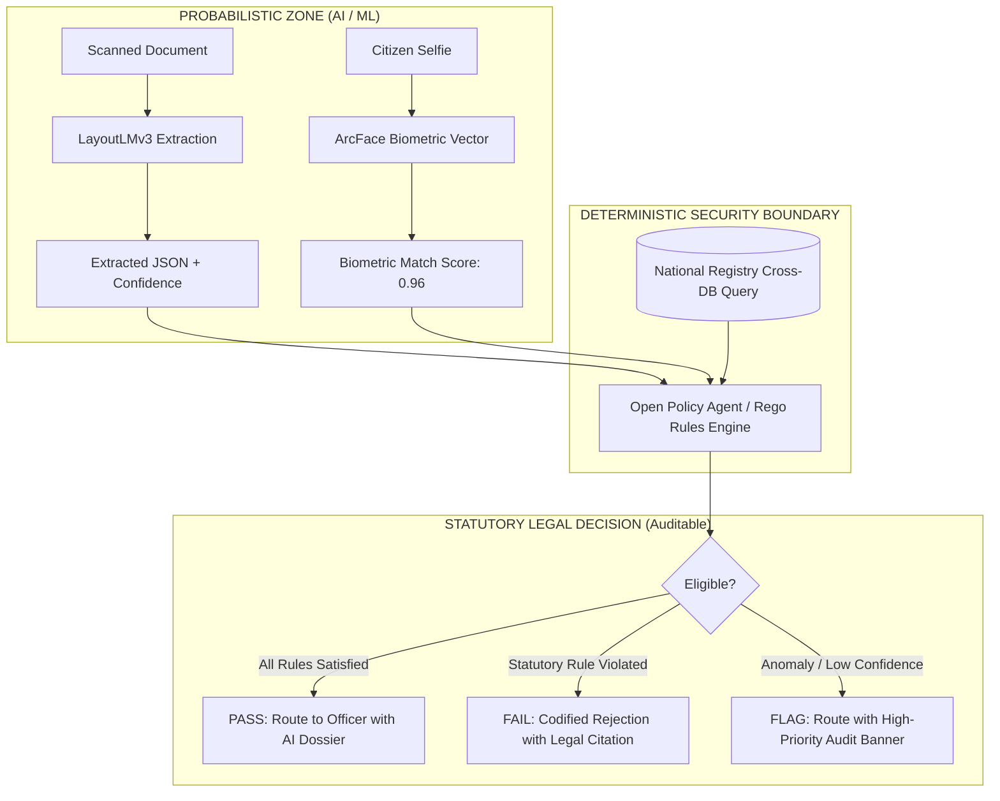
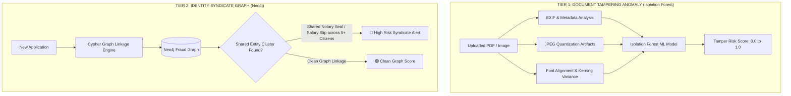

# AI Document Processing, Policy Engine & Fraud ML Architecture
## Project: GovPulse Autonomous Digital Government Platform

---

## 1. Multi-Modal AI Document Vision Pipeline

The Document AI engine processes unstructured citizen uploads (scanned PDFs, smartphone photos of tax filings, salary slips, utility bills, notary affidavits) into structured, cryptographically bound JSON data with exact pixel coordinates.

```mermaid
flowchart LR
    InputDoc[Raw Scanned PDF / Image] --> Preprocess[PyMuPDF + OpenCV\nDeskew + De-noise + Normalization]
    Preprocess --> OCR[PaddleOCR / TrOCR\nText & Token Extraction]
    Preprocess --> Vision[Vision Backbone\nResNet / ViT Spatial Grid]
    OCR --> LayoutLM[LayoutLMv3 Multimodal Transformer\nSpatial Coordinate + Token + Visual Layout]
    Vision --> LayoutLM
    LayoutLM --> KeyValues[Key-Value Extraction\nName, DOB, Income, Address, Seals]
    LayoutLM --> BoundingBoxes[Interactive Bounding Box Coordinates\n[x0, y0, x1, y1] + Confidence %]
```

### Extracted Key-Value Entity Schema & Bounding Box Payload:
```json
{
  "document_id": "doc_8f9a2b1c4d",
  "document_type": "ANNUAL_SALARY_CERTIFICATE",
  "ocr_engine": "LayoutLMv3-Gov-FineTuned",
  "confidence_overall": 0.982,
  "entities": {
    "applicant_name": {
      "value": "Ananya Sharma",
      "confidence": 0.994,
      "bounding_box": [124, 210, 480, 245],
      "page": 1
    },
    "gross_annual_income": {
      "value": 180000,
      "currency": "INR",
      "confidence": 0.988,
      "bounding_box": [310, 540, 520, 575],
      "page": 1
    },
    "tax_identification_number": {
      "value": "ABCDE1234F",
      "confidence": 0.991,
      "bounding_box": [124, 305, 380, 340],
      "page": 1
    },
    "notary_seal_detected": {
      "value": true,
      "seal_type": "OFFICIAL_STATE_REVENUE_SEAL",
      "confidence": 0.965,
      "bounding_box": [620, 780, 840, 990],
      "page": 1
    }
  }
}
```

---

## 2. Biometric Vector Identity Verification (ArcFace)

To prevent synthetic identity fraud and personation, GovPulse uses **ArcFace (Additive Angular Margin Loss)** to generate 512-dimensional facial embedding vectors.

$$\text{Cosine Similarity} = \frac{\mathbf{u} \cdot \mathbf{v}}{\|\mathbf{u}\|_2 \|\mathbf{v}\|_2}$$

```
┌─────────────────────────────────────────────────────────────────────────────────────────┐
│                              BIOMETRIC VERIFICATION LOGIC                               │
├─────────────────────────────────────────────────────────────────────────────────────────┤
│ Vector A: Live Citizen Camera Selfie (Extracted during WebAuthn onboarding)             │
│ Vector B: Scanned Photo from National ID Card (Extracted via LayoutLMv3)                │
│                                                                                         │
│ • If Cosine Similarity >= 0.92: Identity Authenticated (PASS)                           │
│ • If 0.80 <= Cosine Similarity < 0.92: Flag for Secondary Officer Biometric Check     │
│ • If Cosine Similarity < 0.80: FAIL (High Risk Fraud Alert Triggered)                   │
└─────────────────────────────────────────────────────────────────────────────────────────┘
```

---

## 3. Strict Boundary: Probabilistic AI vs. Deterministic Policy Engine

> **Fundamental Principle:** AI is strictly restricted to **data extraction, visual normalization, and anomaly scoring**. AI is **never** permitted to invent, interpret, or decide statutory government eligibility. Eligibility decisions are executed exclusively by a 100% deterministic, auditable **Open Policy Agent (OPA)** rules engine.



### Complete Open Policy Agent (Rego) Statutory Ruleset:

```rego
package government.certificate.income

import future.keywords.in

default allow_issuance = false
default route_to_supervisory_audit = false

# Statutory Law: Karnataka State Revenue Act §14(b) - Income Certificate Rules
MAX_PERMISSIBLE_INCOME := 250000
MIN_RESIDENCE_YEARS := 5
MIN_BIOMETRIC_CONFIDENCE := 0.90
MAX_PERMISSIBLE_FRAUD_RISK := 0.20

# 1. Statutory Eligibility Check (Deterministic)
allow_issuance {
    input.extracted_data.annual_income <= MAX_PERMISSIBLE_INCOME
    input.extracted_data.residence_duration_years >= MIN_RESIDENCE_YEARS
    input.biometric_similarity >= MIN_BIOMETRIC_CONFIDENCE
    input.fraud_ml.tamper_risk_score < MAX_PERMISSIBLE_FRAUD_RISK
    input.extracted_data.notary_seal_detected == true
    not has_duplicate_active_certificate
}

# 2. Duplicate Certificate Protection
has_duplicate_active_certificate {
    input.registry_cross_check.active_certificate_exists == true
}

# 3. Mandatory Supervisory Audit Trigger
route_to_supervisory_audit {
    input.extracted_data.annual_income <= MAX_PERMISSIBLE_INCOME
    input.fraud_ml.tamper_risk_score >= MAX_PERMISSIBLE_FRAUD_RISK
}

# 4. Detailed Statutory Reason Codes
reasons[reason] {
    input.extracted_data.annual_income > MAX_PERMISSIBLE_INCOME
    reason := "Statutory Violation §14(b): Annual income exceeds the statutory threshold of ₹2,50,000"
}

reasons[reason] {
    input.extracted_data.residence_duration_years < MIN_RESIDENCE_YEARS
    reason := "Statutory Violation §9(a): Continuous residence duration is less than the required 5 years"
}

reasons[reason] {
    input.biometric_similarity < MIN_BIOMETRIC_CONFIDENCE
    reason := "Identity Verification Failure: Biometric photo match confidence below national threshold"
}
```

---

## 4. Fraud ML & Syndicate Graph Analysis (Isolation Forest + Neo4j)

GovPulse defends against sophisticated fraud rings using a two-tier detection architecture:



### Neo4j Cypher Query for Cross-Application Fraud Syndicates:

```cypher
// Detect if the same salary certificate hash or notary seal is reused across different citizen IDs
MATCH (c1:Citizen)-[:SUBMITTED]->(a1:Application)-[:CONTAINS_DOC]->(d:Document)<-[:CONTAINS_DOC]-(a2:Application)<-[:SUBMITTED]-(c2:Citizen)
WHERE c1.national_id <> c2.national_id
RETURN c1.national_id AS Applicant1, 
       c2.national_id AS Applicant2, 
       d.sha256_hash AS SharedDocumentHash, 
       d.doc_type AS ReusedDocumentType;
```

---

## 5. Visual Diff Inspection Engine (Officer Desk)

To empower the single responsible officer, GovPulse generates an **Interactive Visual Diff View**:

```
┌─────────────────────────────────────────────────────────────────────────────────────────┐
│                              OFFICER VISUAL DIFF WORKSPACE                              │
├────────────────────────────────────────────┬────────────────────────────────────────────┤
│ SCANNED ORIGINAL DOCUMENT (Interactive BBox)│ AUTO-EXTRACTED DATA & REGISTRY CROSS-MATCH │
├────────────────────────────────────────────┼────────────────────────────────────────────┤
│ [Doc Image Preview]                        │ • Applicant Name: Ananya Sharma   [✅ 99.4%]│
│ ┌────────────────────────────────────────┐ │ • Gross Income:   ₹1,80,000       [✅ 98.8%]│
│ │ [BBox 1: Name: Ananya Sharma]          │ │ • Tax ID (PAN):   ABCDE1234F      [✅ Valid]│
│ │                                        │ │ • Tax Dept Cross-Check: Verified  [✅ Match]│
│ │ [BBox 2: Income: Rs. 1,80,000/-]       │ │ • Address Match:  100% Match      [✅ Match]│
│ │                                        │ │ • Notary Seal:    Verified Active [✅ Valid]│
│ │ [BBox 3: Official Seal & Signature]    │ │ • Biometric Cosine Similarity:     96.4%   │
│ └────────────────────────────────────────┘ │ • Overall Fraud Risk Score:        4.2%    │
├────────────────────────────────────────────┴────────────────────────────────────────────┤
│ OPA Legal Policy Status: ✅ ELIGIBLE UNDER STATUTE §14(b)                              │
│ Action: [ 🖊️ APPROVE & ECDSA DIGITAL SIGN ]   [ ❓ QUERY CITIZEN ]   [ ❌ REJECT ]     │
└─────────────────────────────────────────────────────────────────────────────────────────┘
```
