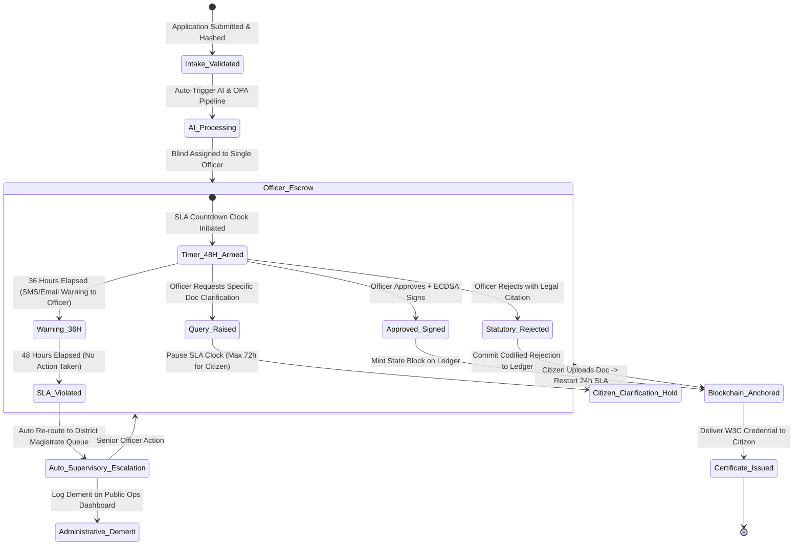
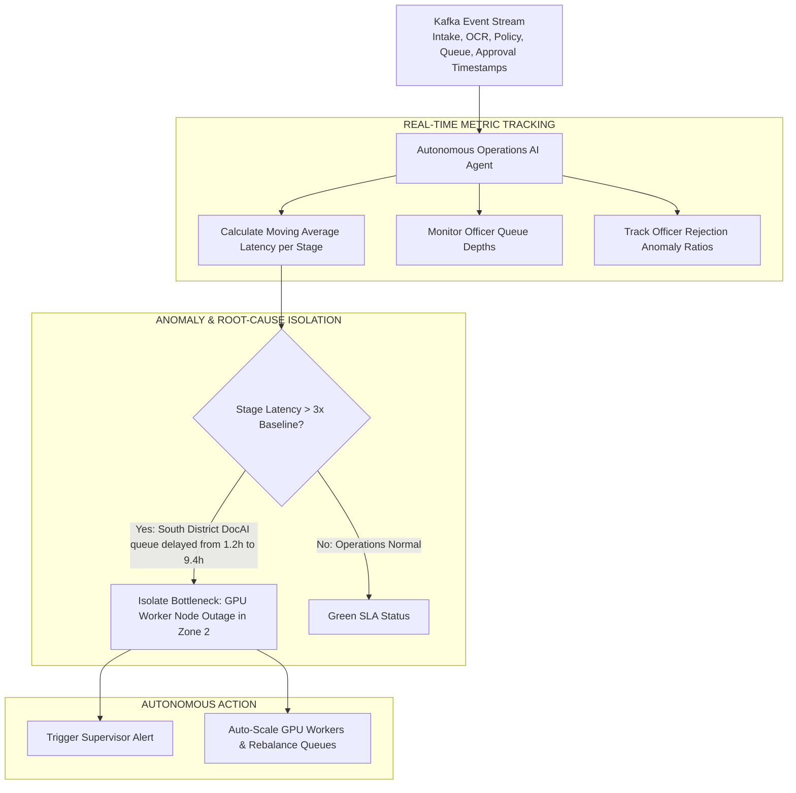

# Anti-Corruption Workflow, Blind Dispatch & SLA Escrow Architecture
## Project: GovPulse Autonomous Digital Government Platform

---

## 1. Anti-Corruption Core Strategy

Traditional government bureaucracies suffer from three primary corruption vectors:
1. **Collusive Evaluator Selection**: Citizens pay bribes to ensure their file is routed to a specific corrupt clerk.
2. **Deliberate Delay (Rent-Seeking)**: Officers intentionally stall files for weeks until an informal expediting fee is paid.
3. **Discretionary Opacity**: Applications are rejected with vague, undocumented excuses, forcing citizens into informal negotiations.

GovPulse introduces three mathematically enforceable, automated counter-mechanisms:

```
┌─────────────────────────────────────────────────────────────────────────────────────────┐
│                           GOVPULSE ANTI-CORRUPTION PILLARS                              │
├─────────────────────────────────────────────────────────────────────────────────────────┤
│ 1. Blind Algorithmic Dispatch: Cryptographic pseudo-random assignment prevents collusion│
│ 2. 48-Hour Strict SLA Escrow: Hard-locked Temporal state machine auto-escalates delays │
│ 3. Codified Rejection Auditing: Every rejection requires statutory legal code on-chain │
│ 4. Autonomous Operations AI: Self-monitoring anomaly agent detects localized bottlenecks│
└─────────────────────────────────────────────────────────────────────────────────────────┘
```

---

## 2. Blind Algorithmic Dispatching Protocol

When an application passes AI extraction and OPA policy checks, it is dispatched via **Deterministic Blind Hashing**:

```mermaid
flowchart TD
    App[Validated Application\nAppID + Category + District] --> HashGen[Compute Cryptographic Dispatch Seed\nSeed = HMAC-SHA256(SecretSalt, AppID || TimestampHour)]
    HashGen --> QueueLookup[Query Active Officer Pool in District\nPool = {Officer_1, Officer_2, ..., Officer_N}]
    QueueLookup --> RoundRobin[Filter by Maximum Caseload & Rank]
    RoundRobin --> SelectOfficer[Assign Designated Responsible Officer\nIndex = Seed mod N]
    SelectOfficer --> LockAssignment[Lock Dossier to Officer PKI ID\nNo other officer or clerk can access or transfer]
```

### Mathematical Guarantee:
- The citizen **cannot** request a specific officer.
- The officer **cannot** cherry-pick files from a general queue.
- Re-routing is forbidden except via automated SLA timeout escalation.

---

## 3. Temporal.io 48-Hour Strict SLA Escrow State Machine



---

## 4. Codified Statutory Rejection Protocol

Officers are strictly prohibited from entering free-form text rejections. To reject an application, the officer must select from a legally codified registry of statutory violations:

```json
{
  "action": "REJECT_APPLICATION",
  "application_id": "APP-2026-INC-49201",
  "officer_id": "OFFICER-REV-4091",
  "statutory_rejection_code": "STATUTE_KAR_REV_ACT_SEC_14B_INCOME_EXCEEDED",
  "statutory_legal_citation": "Karnataka State Revenue Act §14(b): Certified annual income exceeds ₹2,50,000",
  "verified_evidence_ref": "SHA256:4a5c6e8d... (Salary Certificate shows ₹3,40,000)",
  "officer_digital_signature": "3045022100d3b...f82a",
  "timestamp": 1787886400
}
```
Both approvals and rejections are committed to the permissioned blockchain, creating an immutable record that exposes biased rejection patterns.

---

## 5. Autonomous Operations Intelligence & Bottleneck Detection

GovPulse includes a **Self-Monitoring Anomaly Agent** that operates 24/7 over the processing event stream:



### Anomaly Diagnostic Alert Schema:
```json
{
  "alert_id": "OPS-ANOMALY-8821",
  "severity": "CRITICAL",
  "detected_at": "2026-08-28T03:02:00Z",
  "anomaly_type": "PROCESSING_LATENCY_SPIKE",
  "affected_department": "Department of Social Welfare",
  "affected_district": "Bangalore South",
  "baseline_processing_time_hours": 3.2,
  "current_processing_time_hours": 18.7,
  "isolated_stage": "DOCUMENT_AI_EXTRACTION",
  "root_cause_analysis": "Sudden 400% surge in scanned affidavit uploads causing GPU worker queue saturation.",
  "automated_remediation_action": "Spun up 4 additional LayoutLMv3 PyTorch GPU inference worker pods on Kubernetes node pool."
}
```
