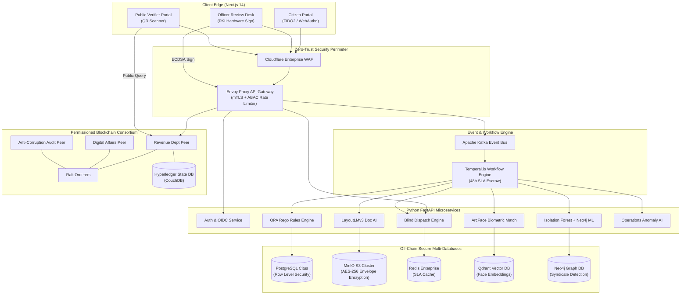
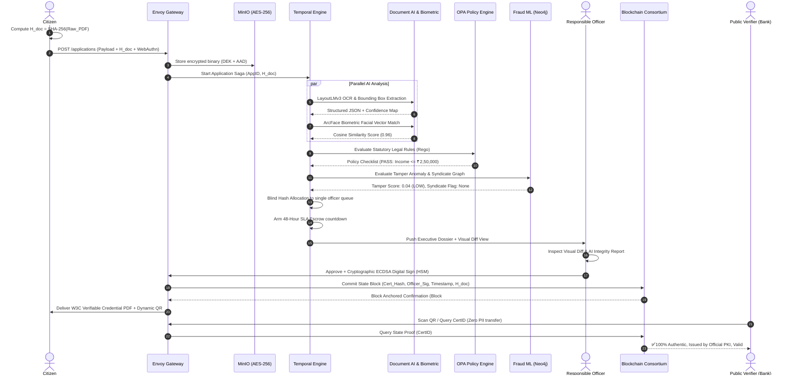
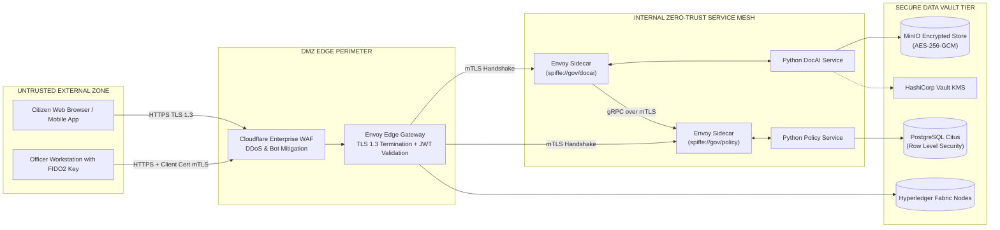
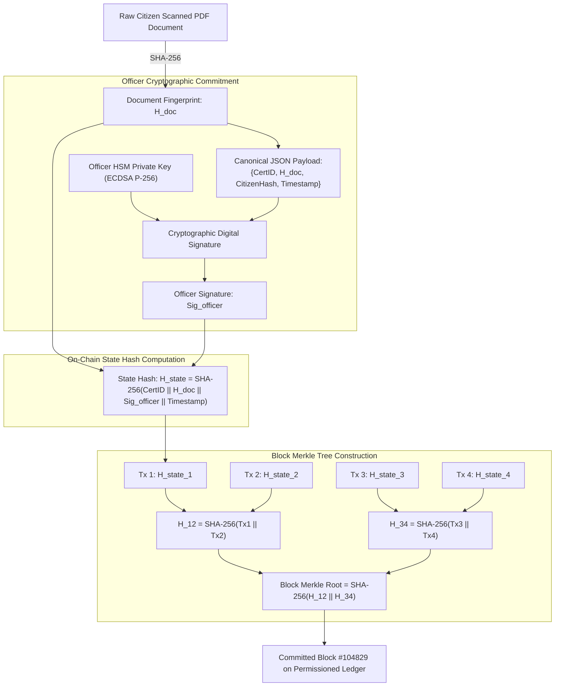
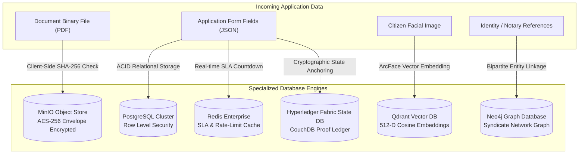
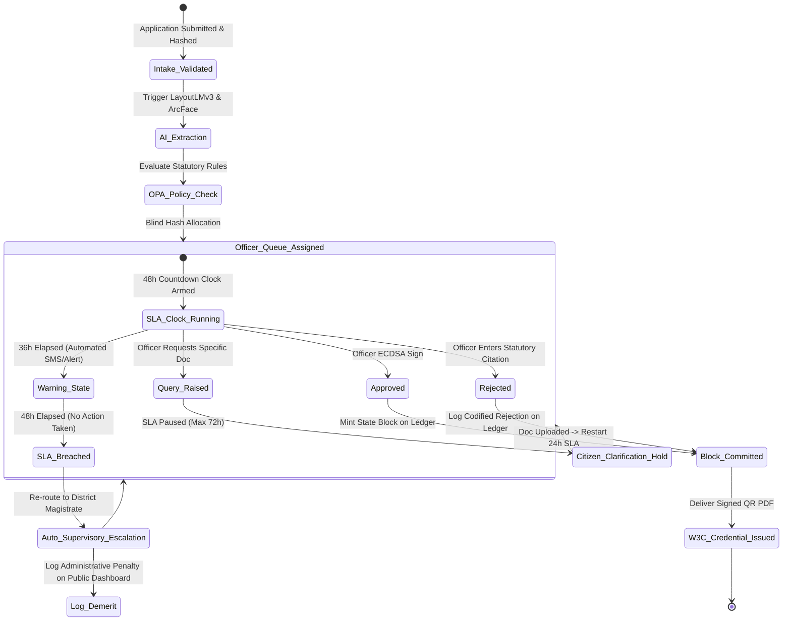

# Master Visual Diagrams & System Flows Compendium
## Project: GovPulse Autonomous Digital Government Platform

This document serves as the master visual engineering reference, illustrating all structural boundaries, cryptographic protocols, state machines, and data synchronization flows.

---

## Diagram 1: High-Level Enterprise System Topology

---

## Diagram 2: Complete End-to-End Processing & Decision Flow

---

## Diagram 3: Zero-Trust Security Boundary & Network Topology

---

## Diagram 4: Cryptographic Hashing & Merkle Anchoring Pipeline

---

## Diagram 5: Multi-Tier Database Interconnection Architecture

---

## Diagram 6: 48-Hour SLA Escrow State Machine

