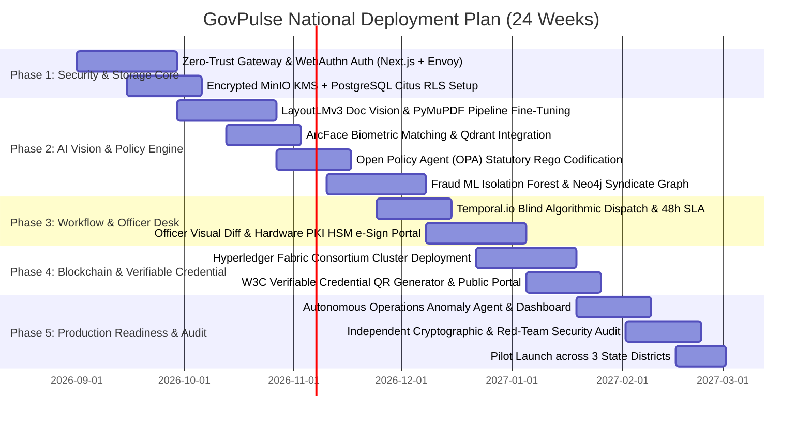
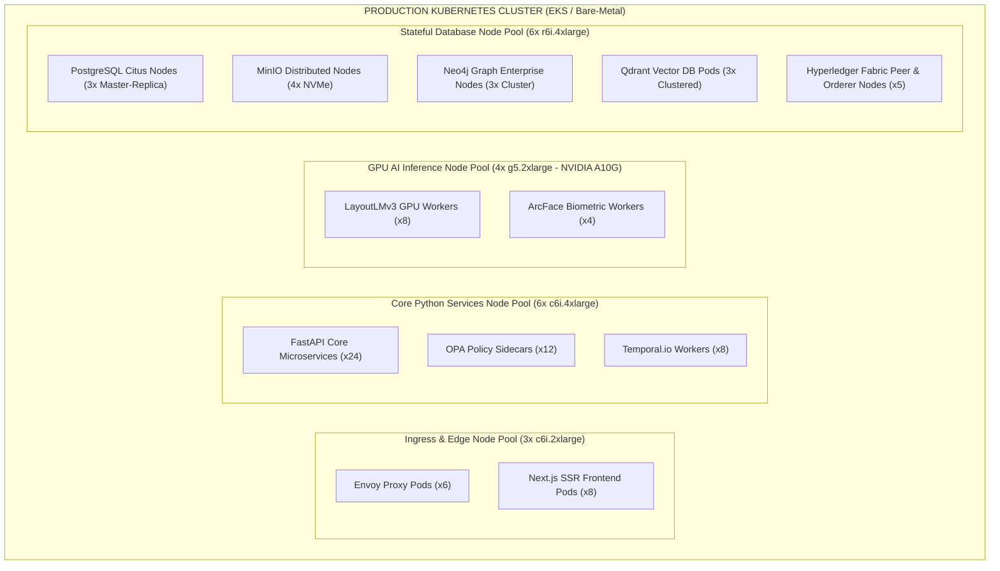

# Enterprise Implementation Roadmap, Infrastructure Sizing & Compliance
## Project: GovPulse Autonomous Digital Government Platform

---

## 1. 24-Week Phased Implementation Roadmap



---

## 2. Production Infrastructure & Kubernetes (K8s) Cluster Sizing

To handle **10,000 concurrent submissions / min** with sub-minute AI turnaround and 99.99% availability:



---

## 3. High Availability, Disaster Recovery (DR) & RTO/RPO

| Metric | Target SLA | Implementation Strategy |
|---|---|---|
| **High Availability (HA)** | **99.99%** (< 52 min annual downtime) | Multi-Availability-Zone (Multi-AZ) active-active deployment across 3 independent data centers. |
| **Recovery Point Objective (RPO)** | **< 0 Seconds (Zero Data Loss)** | Synchronous replication on PostgreSQL WAL + Raft consensus across Hyperledger Fabric ordering peers. |
| **Recovery Time Objective (RTO)** | **< 60 Seconds** | Automated Kubernetes pod failover, AWS Route 53 health-check DNS failover, and Envoy circuit breakers. |

---

## 4. Government Compliance & Regulatory Adherence

```
┌─────────────────────────────────────────────────────────────────────────────────────────┐
│                               REGULATORY COMPLIANCE MATRIX                              │
├─────────────────────────────────────────────────────────────────────────────────────────┤
│ 1. Zero PII On-Chain: Complete GDPR / Right-to-be-Forgotten Compliance                  │
│ 2. ISO/IEC 27001: Information Security Management System (ISMS) Standards               │
│ 3. SOC 2 Type II: Certified Security, Confidentiality, and Processing Integrity         │
│ 4. NIST SP 800-207: Complete Zero-Trust Architecture Alignment                          │
│ 5. W3C Verifiable Credentials Data Model v2.0: Global Interoperability                  │
│ 6. FIPS 140-3 Level 3: Hardware Security Module (HSM) Cryptographic Key Protection     │
└─────────────────────────────────────────────────────────────────────────────────────────┘
```

---

## 5. Security Red-Team & Cryptographic Audit Strategy

Prior to public launch, the system undergoes three mandatory verification gates:
1. **Automated Dynamic & Static Security Scanning**:
   - SAST (SonarQube / Bandit for Python), DAST (OWASP ZAP), Dependency scanning (Trivy / Snyk).
2. **Independent Cryptographic Audit**:
   - Verification of SHA-256 state hash mathematical generation, Merkle tree construction, ECDSA signature non-malleability, and HSM PKCS#11 key isolation.
3. **Black-Box Penetration Testing**:
   - Simulated adversarial attacks: Token theft, forged OCR document injection, collusion attempts to bypass blind dispatching, and DDoS stress testing up to 50,000 req/sec.
