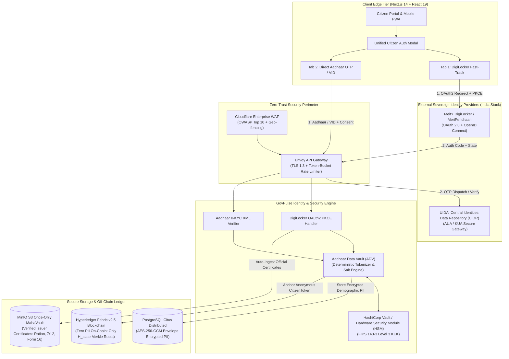
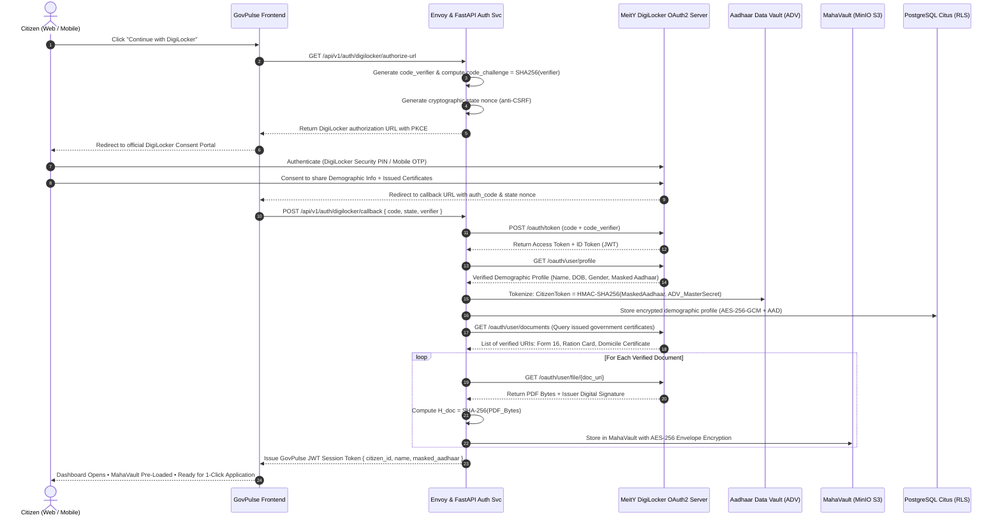
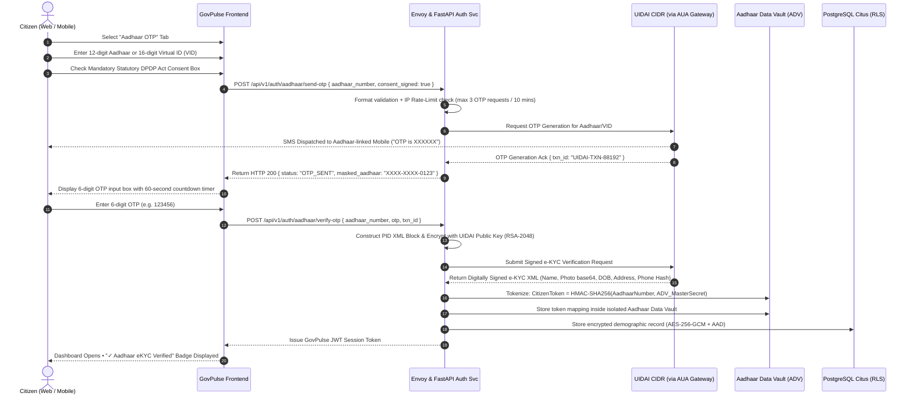

# Sovereign Citizen Identity Architecture: Unified Hybrid DigiLocker & Aadhaar e-KYC Engine (Option D)

**Project:** MahaGov-Pulse (Government of Maharashtra Autonomous Citizen Service Platform)  
**Standard:** India Stack (UIDAI e-KYC + MeitY DigiLocker OAuth 2.0 / MeriPehchaan)  
**Security Tier:** Aadhaar Data Vault (ADV) Tokenization • Zero PII On-Chain • FIPS 140-3 Level 3 HSM  

---

## 1. Architectural Decision Record (ADR-009)

- **Status:** **APPROVED / RECOMMENDED FOR PRODUCTION**
- **Decision:** Implement **Option D (Unified Hybrid Architecture)** combining **DigiLocker OAuth 2.0 (PKCE) / MeriPehchaan** as the primary fast-track onboarding channel and **Direct Aadhaar OTP e-KYC** as the universal fallback channel.
- **Problem Statement:** How to provide 100% citizen onboarding across Maharashtra without excluding non-DigiLocker rural citizens, while preventing illegal raw Aadhaar storage and automatically pre-populating verified income/domicile/ration documents into MahaVault.
- **Key Trade-Offs Analyzed:**
  - *Only DigiLocker:* High automation and instant document pull, but excludes rural/elderly citizens without DigiLocker accounts (~60% of population).
  - *Only Aadhaar OTP:* Universal coverage (~95% adults), but requires manual scanning of supporting certificates and risks severe UIDAI regulatory penalties if raw numbers are stored without an Aadhaar Data Vault.
  - *Unified Hybrid (Option D):* Solves both problems simultaneously. Tech-savvy citizens enjoy 1-click login with instant MahaVault pre-fill; direct Aadhaar holders enjoy 10-second SMS OTP onboarding. Both converge into the same tokenized Aadhaar Data Vault (ADV).

---

## 2. High-Level System Topology (Option D)



---

## 3. End-to-End Visual Sequence Flows

### Diagram A: Path 1 — DigiLocker Fast-Track with Automatic MahaVault Synchronization



---

### Diagram B: Path 2 — Direct Aadhaar OTP e-KYC via UIDAI Gateway



---

## 4. Four Pillars of Identity Security & Data Protection

| Security Pillar | Architectural Implementation | Regulatory Standard |
|---|---|---|
| **1. Aadhaar Data Vault (ADV)** | The 12-digit raw Aadhaar is never saved in databases or logs. Deterministically converted to `CitizenToken = HMAC-SHA256(Aadhaar, HSM_Key)`. | UIDAI Circular F.No. 11020/205/2017 |
| **2. Zero PII On-Chain** | Hyperledger Fabric records zero cleartext names, photos, or Aadhaar numbers. Only `H_state = SHA256(...)` is committed. | DPDP Act 2023 §8 & GDPR Art. 17 (Right to Erasure) |
| **3. Mandatory 8-Digit Masking** | UI, APIs, and PDF certificates only expose `XXXX-XXXX-1234`. First 8 digits permanently masked. | Aadhaar Act 2016 §29 & RBI Guidelines |
| **4. AES-256-GCM Envelope Encryption** | Demographic PII in PostgreSQL Citus encrypted using per-user DEKs wrapped by HashiCorp Vault / HSM KEK. | FIPS 140-3 Level 3 & ISO/IEC 27001 |

---

## 5. Statutory & Regulatory Compliance Matrix

| Regulatory Framework | Mandatory Requirement | MahaGov-Pulse Implementation |
|---|---|---|
| **Aadhaar Act 2016 §8** | Mandatory informed consent prior to e-KYC authentication. | Bilingual (Marathi & English) consent modal with explicit checkbox and immutable audit trail. |
| **Aadhaar Act 2016 §29** | Strict prohibition against sharing core biometric information or raw Aadhaar numbers. | Biometrics are never stored; raw Aadhaar tokenized into ADV; only masked Aadhaar exposed. |
| **Supreme Court Judgment (2018)** | Disallow private mandatory Aadhaar; mandate Virtual ID (VID) alternatives. | Support for 16-digit revocable Virtual ID (VID) and voluntary DigiLocker OAuth2 sign-in. |
| **India DPDP Act 2023 §6** | Clear, itemized, and transparent data collection notice with purpose limitation. | Data collected solely for issuing official certificates under the Maharashtra RTS Act 2015. |
| **India DPDP Act 2023 §8** | Right to Correction and Right to Erasure of personal data. | Off-chain envelope crypto allows cryptographic erasure without breaking blockchain hash validity. |
| **MeitY DigiLocker Guidelines** | Adherence to OAuth 2.0 RFC 6749 and PKCE RFC 7636 standards. | Full SHA-256 PKCE challenge-verifier exchange with cryptographic state nonce verification. |

---

## 6. Frontend Citizen Authentication Experience Blueprint

```
┌──────────────────────────────────────────────────────────────────────────┐
│ 🏛️ MahaGov-Pulse | Government of Maharashtra Citizen Identity Access    │
│ Official Sovereign Gateway • RTS Act 2015 & DPDP Act 2023 Compliant       │
├──────────────────────────────────────────────────────────────────────────┤
│                                                                          │
│   ┌───────────────────────────┐    ┌─────────────────────────────────┐   │
│   │ ⚡ Continue with DigiLocker │    │ 📱 Direct Aadhaar OTP e-KYC     │   │
│   │ (Fast-Track + Auto Vault) │    │ (Aadhaar Number or 16-digit VID)│   │
│   └───────────────────────────┘    └─────────────────────────────────┘   │
│                                                                          │
│   [TAB 1 CONTENT: DIGILOCKER FAST-TRACK]                                 │
│   • 1-Click Login via MeitY National MeriPehchaan SSO                    │
│   • Automatically syncs your official Ration Card, Form 16, and Domicile │
│   • Zero document scanning required                                      │
│                                                                          │
│   [ 🚀 Continue with DigiLocker ]                                        │
│                                                                          │
│   ── OR ──                                                               │
│                                                                          │
│   [TAB 2 CONTENT: DIRECT AADHAAR OTP]                                    │
│   Enter 12-digit Aadhaar / 16-digit VID:                                 │
│   [ 1234 - 5678 - 9012                     ] [ Get OTP ]                 │
│                                                                          │
│   Enter 6-digit OTP sent to registered mobile:                           │
│   [ •  •  •  •  •  • ] (Resend in 45s)                                   │
│                                                                          │
│   [  Verify & Secure Sign-In ]                                           │
│                                                                          │
│   ☑ Bilingual Statutory Consent:                                         │
│     "I hereby consent to provide my Aadhaar/DigiLocker credentials for   │
│      statutory certificate issuance under the Maharashtra RTS Act 2015   │
│      and the Digital Personal Data Protection (DPDP) Act 2023."          │
└──────────────────────────────────────────────────────────────────────────┘
```
