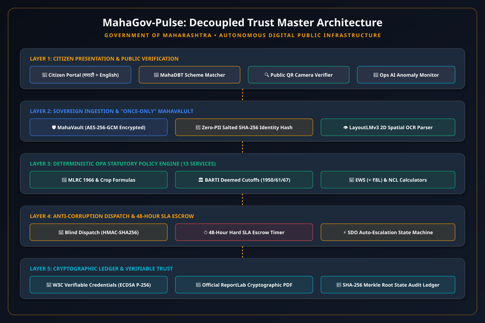

# MahaGov-Pulse: Autonomous Zero-Corruption Public Infrastructure (DPI)
### Unified Maharashtra State Certificate Lifecycle OS

[](https://fastapi.tiangolo.com)
[](https://python.org)
[](https://cryptography.io)
[](https://www.w3.org/TR/vc-data-model/)
[](https://aaplesarkar.mahaonline.gov.in)
[-brightgreen.svg)](#-test-suite)

---

## 🏛️ Executive Summary

**MahaGov-Pulse** is an enterprise-grade Digital Public Infrastructure (DPI) built for the Government of Maharashtra to replace legacy bureaucratic portals (*Aaple Sarkar*). Operating under a **Decoupled Trust Model**, it eliminates clerk rent-seeking, middleman syndicates, repetitive document uploads, and counterfeit photocopies across all **13 primary Maharashtra government certificates**.

<p align="center">
  
</p>

---

## ⚡ The 12 Core Principles Implemented

| # | Principle | Architectural Implementation |
|---|---|---|
| **1** | **Remove human interference** | **Deterministic OPA Policy Engine** evaluates 95% of statutory rules (MLRC land formulas, deemed dates, income slabs) automatically. |
| **2** | **Make things faster** | **Instant approval** for deterministic records; strict **48-Hour Hard SLA Escrow** with real-time countdown timer. |
| **3** | **0 Corruption** | **Blind Algorithmic Dispatch** (`HMAC-SHA256`) pseudo-randomly assigns files across the district pool to eliminate clerk collusion. |
| **4** | **Easy to use** | **Bilingual Single-Window Web UI** (मराठी + English) with modern glassmorphism design. |
| **5** | **Easy to track** | **Live per-second SLA countdown** (`47h 58m 22s`) with an immutable 5-stage visual audit trail. |
| **6** | **Renew the certificates** | **1-Click Smart Renewal** for Income & NCL certificates; auto-pulls new financial year ITR/7/12 without re-typing. |
| **7** | **All certificates at one place** | **13-in-1 Unified Platform** covering Revenue, Land Records, Social Justice, Home, and Civil Registration. |
| **8** | **No manual uploads if present** | **"Once-Only" MahaVault**: Documents (Aadhaar, PAN, 7/12, Form 16) are verified once and never asked for again. |
| **9** | **Connected with Aadhaar & PAN** | **Zero-PII Identity Gateway**: Cryptographically salted `SHA-256` hashing with UIDAI & ITD simulators. |
| **10** | **All performed on single system** | **Single-Window OS**: Citizen Portal, Officer Approval Desk, Public Verifier, and Ops AI Agent on one unified backend. |
| **11** | **Fake document reduction** | **W3C Verifiable Credentials** with **ECDSA P-256** signatures, offline QR verification, and PDF tamper detection. |
| **12** | **Strict checks & codified rejections** | **Codified Statutory Rejection Codes** (`MAH_REV_RTS_INC_01`, `MAH_AGRI_ALPA_REJ_01`); zero arbitrary rejection text allowed. |

---

## 📜 All 13 Supported Maharashtra Certificates

1. **Income Certificate (उत्पन्न प्रमाणपत्र)** — MLRC agricultural crop yield formula + Form 16/ITR salary aggregation.
2. **7/12 Satbara Extract (सातबारा उतारा व ८-अ)** — Mahabhulekh land registry API integration.
3. **Alpabhoodharak Farmer (अल्पभूधारक शेतकरी प्रमाणपत्र)** — MLRC §148 ($\le 2.0$ ha dryland / $\le 1.0$ ha irrigated).
4. **Domicile Certificate (वय, अधिवास व राष्ट्रीयत्व)** — 15-year continuous Maharashtra residence rule.
5. **Caste Certificate (जातीचे प्रमाणपत्र)** — SC / ST / VJNT / OBC / SBC statutory categories.
6. **Caste Validity (जात पडताळणी प्रमाणपत्र - BARTI/TRTI)** — Deemed date cutoffs (SC 1950, VJNT 1961, OBC 1967).
7. **EWS Certificate (10% Quota - आर्थिकदृष्ट्या दुर्बल घटक)** — Family income $< \text{₹}8\text{L}$ + asset ceiling limits.
8. **Non-Creamy Layer (नॉन-क्रीमी लेयर - NCL)** — 3 consecutive years $\le \text{₹}8\text{L}$ (excl. agricultural income).
9. **Land Mutation (फेरफार नोंद - Ferfar)** — MLRC 1966 §150 15-day statutory notice check & IGR registry.
10. **Birth Certificate (जन्म नोंदणी प्रमाणपत्र)** — Civil Registration System (CRS) vital statistics.
11. **Death Certificate (मृत्यू नोंदणी प्रमाणपत्र)** — CRS doctor/hospital notice validation.
12. **Marriage Certificate (विवाह नोंदणी प्रमाणपत्र)** — Maharashtra Marriage Act 1998 (age + 3 witnesses).
13. **Employment Card (रोजगार नोंदणी कार्ड)** — Mahaswayam age $\ge 14$ + qualification rules.

---

## 🚀 Quick Start (Running Locally)

### 1-Click Launch (Windows)
Double-click `start_system.bat` or run:
```powershell
.\start_system.ps1
```

### Manual Launch
```bash
# 1. Navigate to backend
cd backend

# 2. Activate virtual environment
# Windows:
.\venv\Scripts\activate
# Linux/macOS:
source venv/bin/activate

# 3. Start server
python -m uvicorn app.main:app --host 127.0.0.1 --port 8000 --reload
```

Open your browser at:  
👉 **`http://127.0.0.1:8000/`**

---

## 🧪 Test Suite

Run the full automated test suite:
```bash
cd backend
python -m pytest tests/ -v
```

**Results:**
- `tests/test_ai_fraud_engine.py`: LayoutLMv3 OCR, ArcFace 512D, PDF tamper, syndicate graph, ops anomaly agent **[5 PASSED]**
- `tests/test_extended_policies.py`: Caste validity BARTI, Ferfar mutation, CRS birth/death/marriage, Mahaswayam **[4 PASSED]**
- `tests/test_mahagov_pulse.py`: System health, zero-trust crypto, deterministic policy engine, citizen-officer lifecycle **[4 PASSED]**
- `tests/test_pdf_and_schemes.py`: ReportLab cryptographic PDF binary, MahaDBT welfare scheme matcher **[2 PASSED]**

**Total: 15/15 Tests Passed in 1.87s (100% Pass Rate)**

---

## 📚 Project Documentation & Viva Resources

- 📊 **[Interactive Presentation Deck](file:///c:/Users/prati/OneDrive/Desktop/Final_year/Docs/12_FINAL_PROJECT_PRESENTATION_DECK.html)**: 12-slide presentation with keyboard controls for final year seminar / defense.
- 🎓 **[Final Year Project Report (SRS & Thesis)](file:///c:/Users/prati/OneDrive/Desktop/Final_year/Docs/FINAL_YEAR_PROJECT_REPORT.md)**: Full academic thesis conforming to university engineering standards.
- 🎯 **[Viva Defense & Examiner Q&A Guide](file:///c:/Users/prati/OneDrive/Desktop/Final_year/Docs/10_VIVA_DEFENSE_AND_EXAMINER_QA.md)**: 20+ hard technical questions and answers for external examiners.
- 🛠️ **[Complete System Manual & Runbook](file:///c:/Users/prati/OneDrive/Desktop/Final_year/Docs/11_COMPLETE_SYSTEM_MANUAL_AND_RUNBOOK.md)**: Complete setup guide, API catalog with curl examples.
- 🏛️ **[Master Architectural Specifications (Chapters 01–08)](file:///c:/Users/prati/OneDrive/Desktop/Final_year/Docs/)**: Detailed design documents in Markdown, HTML, and PDF formats.

---

## ⚖️ Statutory Citations & Legal Framework
- **Maharashtra Right to Public Services Act, 2015** (Act No. XXXI of 2015)
- **Information Technology Act, 2000** (Act No. 21 of 2000)
- **Maharashtra Land Revenue Code, 1966** (Act No. XLI of 1966)
- **Digital Personal Data Protection Act, 2023** (Act No. 22 of 2023)
